# Citi Bike rebalancing: every figure and the model
Prefer to listen? [02-figures-and-model.mp3](02-figures-and-model.mp3) reads this document aloud (about 22 minutes).

How to read each of the 13 figures in the report, what it tells us, and the question someone is likely to ask about it. Read `01-background.md` first for the terms (drift, need, room, target band). The figures sit in `figures/`.

The figures tell the story in four acts:

1. **The problem** (figures 1 to 3): bikes flow one way at rush hour, in a fixed pattern.
2. **Can it be planned?** (figures 4 to 7): the pattern repeats enough to plan the night before, and the demand model shows what weather does to volume.
3. **The answer** (figures 8 and 9): our plan against the benchmarks.
4. **What it means on the street** (figures 10 to 13): where the vans go, what is left, and the check against Citi Bike's own numbers.

---

## Act 1: the problem

### Figure 1. The daily rhythm

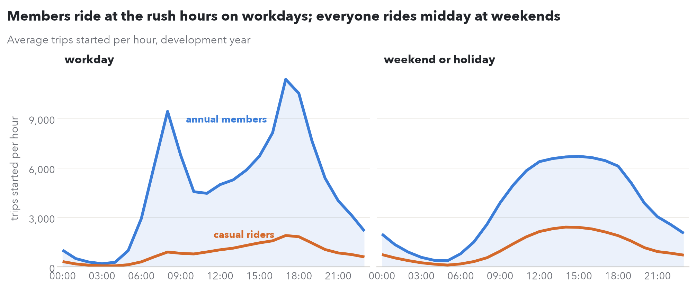

**What it shows.** Average trips started in each hour of the day, over the first year. Left panel workdays, right panel weekends and holidays. Blue line annual members, orange line casual riders.

**How to read it.** The x-axis is the hour, the y-axis trips started in that hour across the whole system. Compare the shape of the two blue lines.

**What it tells us.** On workdays members spike twice: about 9,400 trips in the 08:00 hour and 11,400 at 17:00, with a dip to about 4,500 at 11:00. That's commuting. Casual riders barely change through the day. At weekends both groups follow one gentle midday hump. So the imbalance is a workday commuter effect, and **every rule in the project plans workdays and weekends separately**.

**Likely question.** *Why do members matter more than casual riders?* They take 82% of trips and they ride the same routes at the same times, which is exactly what creates the one-way flow. Casual riders spread out.

### Figure 2. The rush-hour maps

**What it shows.** Every station as a dot. Colour is the station's average net flow (bikes arriving minus bikes leaving) over the workday morning rush, 07:00 to 10:00 (left), and evening rush, 16:00 to 19:00 (right), in the first year. Blue gains bikes, red loses them, grey is even. Bigger dots swing more. The colour scale stops at 15 bikes so smaller stations still show.

**How to read it.** Blue in the morning means that station fills up and risks running out of docks. Red in the morning means it empties and risks running out of bikes. Then compare left to right.

**What it tells us.** In the morning, Midtown and Lower Manhattan are blue and the residential areas around them (the Upper West and Upper East Side, the East Village, much of Brooklyn) are red. Manhattan as a whole gains 935 bikes each morning and Brooklyn loses 1,055. 417 stations lose 5 or more, 294 gain 5 or more, and the biggest gains 111 bikes in three hours. In the evening the colours swap: Manhattan loses 1,263, Brooklyn gains 417. The Bronx, eastern Queens and Jersey City stay grey, so they need little attention.

**Likely question.** *Why don't the evening numbers mirror the morning exactly?* The evening rush is longer and messier: people go out, run errands and ride home later, so some of the return flow lands after 19:00.

### Figure 3. The neighbourhood clock

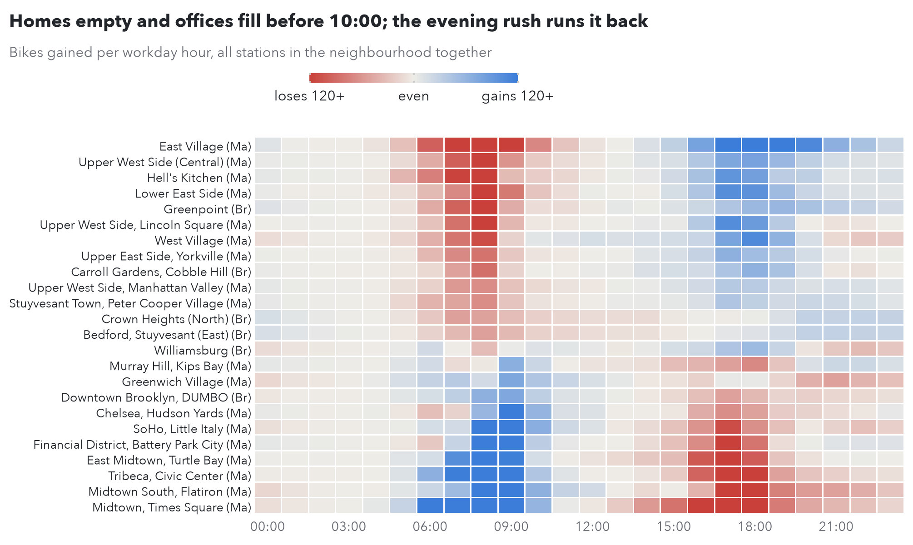

**What it shows.** A heatmap: one row per neighbourhood (the 24 with the biggest swings), one column per hour of a workday. Each cell is the bikes that neighbourhood gains in that hour, all its stations added together. Blue gains, red loses. Rows run from the neighbourhood that loses most in the morning (top) to the one that gains most (bottom). (Ma) is Manhattan, (Br) Brooklyn.

**How to read it.** Read across a row to see one neighbourhood's day. Read down a column to see the whole city at one hour.

**What it tells us.**
- **Home neighbourhoods** (top rows: East Village, Upper West Side, Hell's Kitchen) go red from 06:00 to 10:00 and blue in the evening. The East Village alone loses 726 bikes over the morning rush.
- **Office neighbourhoods** (bottom rows: Midtown and Times Square, Flatiron, Tribeca, the Financial District) are the mirror image: blue in the morning, red from about 15:00 to 19:00. Midtown and Times Square gain 1,119 in the morning.
- **Two details that shape the plan.** Nightlife areas (Williamsburg, the West Village, Greenwich Village) lose bikes again after 21:00. And the office districts drain in a sharp window from 16:00 to 19:00, which is why a **van visit at 14:00** can still help them: it lands just before the drain.

**Likely question.** *Why 14:00 and not noon?* We tested 10:00, 12:00 and 14:00 on the first year. 14:00 turned away the fewest riders because it sets stations up right before the evening drain.

---

## Act 2: can it be planned the night before?

A plan set at 04:00 only works if today looks like the days before. Figures 4 and 5 test that.

### Figure 4. The habit

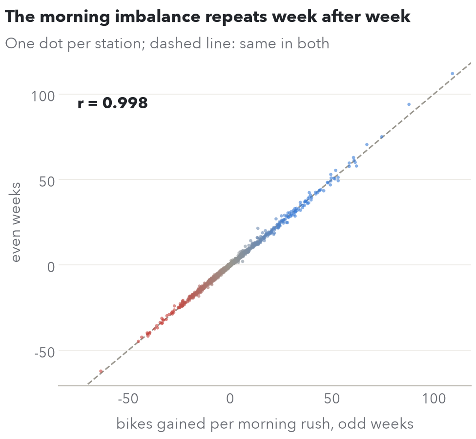

**What it shows.** One dot per station (2,190 of them). The x-axis is the station's average morning-rush net flow in odd-numbered weeks of the first year, the y-axis the same in even weeks. The dashed line is "same in both".

**How to read it.** A dot on the dashed line means the station behaves the same in odd and even weeks. Red dots lose bikes every morning, blue ones gain.

**What it tells us.** The dots sit almost exactly on the line: correlation 0.998. **On average, a station does the same thing every week.** Splitting by odd and even weeks gives two halves of the year that are spread evenly over the seasons, so this isn't a seasonal effect.

**Likely question.** *Doesn't averaging hide day-to-day noise?* Yes, and that's why figure 5 exists.

### Figure 5. One day against the habit

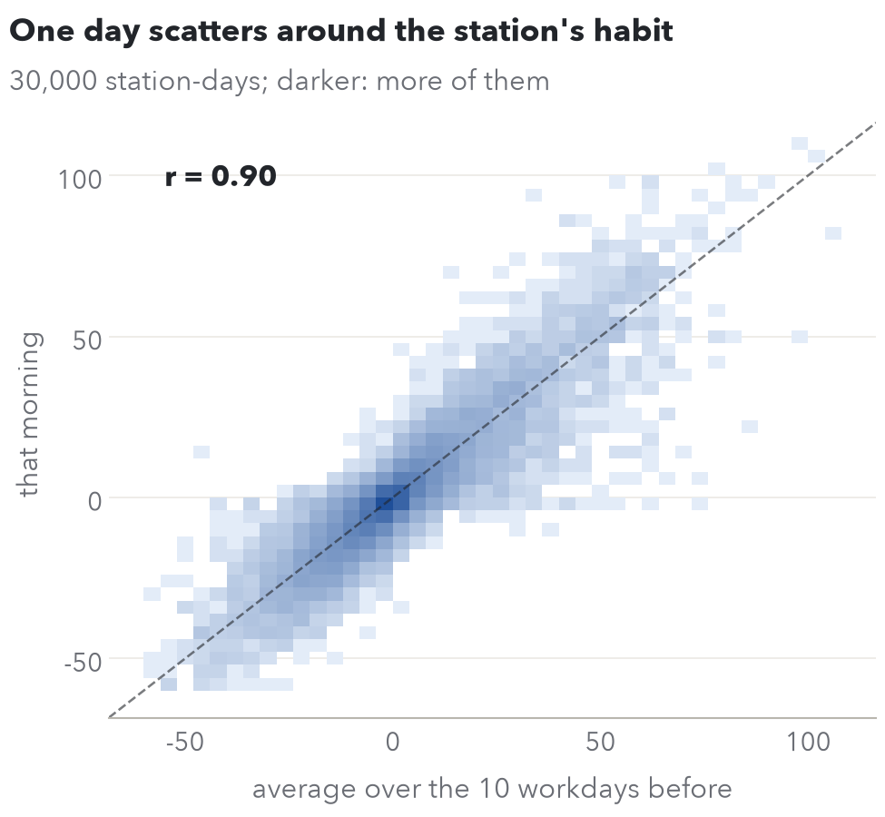

**What it shows.** 30,000 random station-days. The x-axis is the station's average morning-rush net flow over the 10 workdays before, the y-axis what actually happened that morning. Darker squares hold more station-days (it's a 2D histogram, because 30,000 dots would be a blob).

**How to read it.** Points on the dashed line were predicted exactly by the station's recent average. The wider the cloud, the noisier single days are.

**What it tells us.** It still follows the line, but wider: correlation 0.90, and the median station-day misses its 10-day average by 1.6 bikes. **A plan set the night before will be a little off at most stations, and at the big ones sometimes by a lot.** That gap is why perfect foresight (869 riders turned away a day) beats any real plan (1,779), and why recommendation 5 points at better station-level forecasts.

**Likely question.** *Why 10 days?* We tested 5, 10 and 20 on the first year. 20 cut shortages by only 1% while moving 10% more bikes; 5 was too noisy.

### The demand model

Figures 6 and 7 come from a linear regression that forecasts **how many trips the whole system will have tomorrow**. It's the project's statistical model (the target band is a decision rule, not a fitted model).

**The model.** One row per day. Fitted on the first year (364 days), scored on the second.

$$\begin{aligned}
\log(\text{trips}) = {} & \beta_0 + \beta_1\,\text{temp} + \beta_2\,\text{warm excess} + \beta_3\,\text{wet hours} + \beta_4\,\text{snow 3 days} \\
& + \beta_5\,\text{wind} + \beta_6\,\text{weekend} + \beta_7\,\text{Christmas week} + \varepsilon
\end{aligned}$$

| Variable | What it is |
|---|---|
| temp | Average temperature, °C, 07:00 to 21:00 (riding hours; weather at 03:00 changes nobody's plans) |
| warm excess | Degrees above 22 °C, else 0. Lets warmth help up to 22 °C and hurt above it (the scatter levels off there) |
| wet hours | Hours between 07:00 and 21:00 with at least 0.5 mm of rain |
| snow 3 days | Snowfall over the last three days, cm (snow stays on the bike lanes after it stops falling) |
| wind | Average wind speed, km/h, riding hours |
| weekend | 1 for weekends and public holidays |
| Christmas week | 1 from 24 December to 1 January |

**Why log trips.** The weather effects work in percentages, not in fixed numbers of trips: rain costs a bigger share of a summer day's 200,000 trips in absolute terms than of a winter day's 50,000, but about the same percentage. On a log scale, each coefficient reads as a percentage change: a coefficient b means the variable changes trips by $e^b - 1$, which is close to b itself for small b.

**What was left out, and why.**
- **No time trend.** Fitted on one year, a trend can't tell growth from the season, and adding one dropped the test-year R² from 0.87 to 0.71.
- **23 February 2026 is excluded.** Zero trips: the system was shut for snow, and a model of riders' choices can't explain a closure.

### Figure 6. Forecast against reality

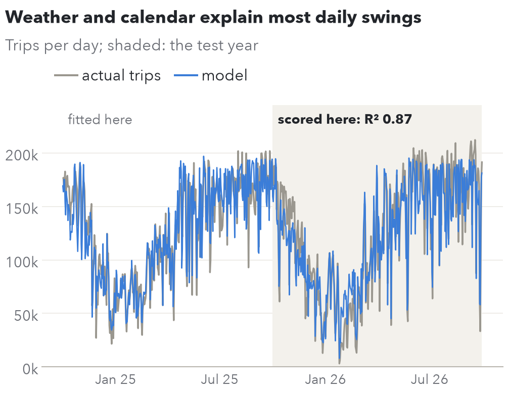

**What it shows.** Every day of the test year: the trips the model predicted (x) against the trips that happened (y). Dashed line is a perfect forecast. Blue workdays, orange weekends, black Christmas week.

**How to read it.** Dots on the line were forecast exactly. Above the line, more people rode than predicted; below, fewer.

**What it tells us.** R² = 0.87 on a year the model never saw: it explains 87% of how much days differ from each other. R² is 1 minus the squared forecast errors divided by the squared distances from the average day. Half of all days land within 11% of the forecast. Christmas week sits low on the left, correctly forecast as quiet.

**Likely question.** *0.87 is good, so why not use it to set station targets?* We tried: stretching each station's 10-day history by tomorrow's forecast volume. On the first year it made decisions worse (more shortages *and* more bikes moved). Knowing how busy the city will be doesn't tell you *where* bikes run out. Gammelli et al. (2021) find the same gap between forecast accuracy and decision quality. So the model's job is sizing the night shift (recommendation 5), not setting station levels.

### Figure 7. What moves a day's riding

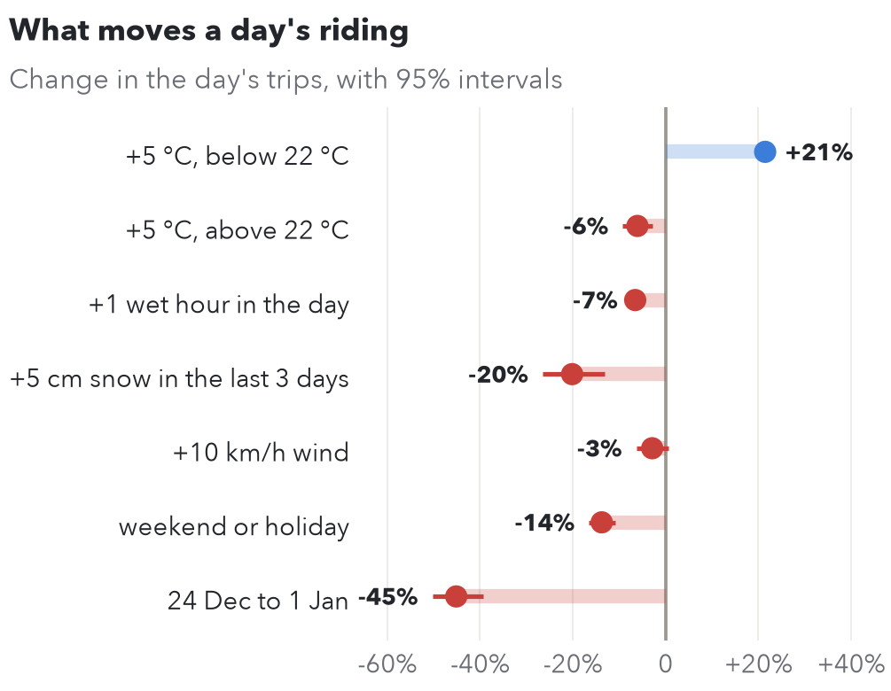

**What it shows.** Each variable's effect on a day's trips, as a percentage, with 95% confidence intervals (the thin line through each dot). Blue raises trips, red lowers them.

**How to read it.** Each row is "change this one thing, keep the rest the same". An interval that doesn't cross zero is clearly not noise.

**What it tells us.**
- **+5 °C below 22 °C: +21%.** Warmth is the biggest everyday driver.
- **+5 °C above 22 °C: −6%.** Past 22 °C, more heat costs riders.
- **One more wet hour: −7%.** A day with five wet hours loses about a third.
- **+5 cm of snow over the last three days: −20%.**
- **+10 km/h of wind: −3%.** Small, and the interval nearly touches zero.
- **Weekend: −14%.**
- **Christmas week: −45%.** The biggest effect: offices empty out.

**Likely question.** *Why is the weekend effect negative, when weekends look busy in figure 1?* Figure 1 shows the *shape* of the day. Over the whole day, a weekend still has 14% fewer trips than a workday with the same weather, because the commute is gone.

---

## Act 3: the answer

### Figure 8. One day at three stations

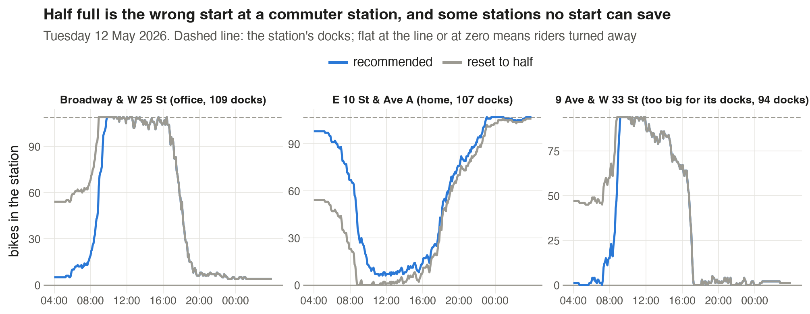

**What it shows.** Bikes in the station through Tuesday 12 May 2026, a dry, ordinary workday, under two plans: the recommended plan (blue) and reset-to-half (grey). Dashed line is the station's docks. **A line flat at the dashed line means riders find no free dock; flat at zero means they find no bike.**

**How to read it.** Each panel is one station from 04:00 to 04:00. Look for where each line goes flat at a limit, and for how long.

**What it tells us.**
- **Broadway & W 25 St, an office station, 109 docks.** Half full starts at 54 and hits the docks by 08:45, then turns away arrivals for most of the morning. The recommended plan starts at 5 and holds out almost an hour longer. Same arrivals, different start.
- **E 10 St & Ave A, a home station, 107 docks.** The mirror image. Half full starts at 54 and is empty from 09:00 to about 16:00. The recommended plan starts near 98 and keeps bikes there all day.
- **9 Ave & W 33 St, by Penn Station, 94 docks.** The day's swing is 181 bikes, nearly twice the docks. Both plans hit the docks. **No starting level can save this station**; it needs more docks or a valet.

This is the whole project in one picture: half full is the wrong start at commuter stations, the band fixes that, and a few stations are beyond any truck plan.

**Likely question.** *Why does the recommended line at the office station still go flat?* The station gains 105 bikes on 109 docks, so even starting near empty it fills up eventually. The plan turns away far fewer riders, but can't make 105 arrivals fit with room to spare.

### Figure 9. Riders turned away against bikes moved

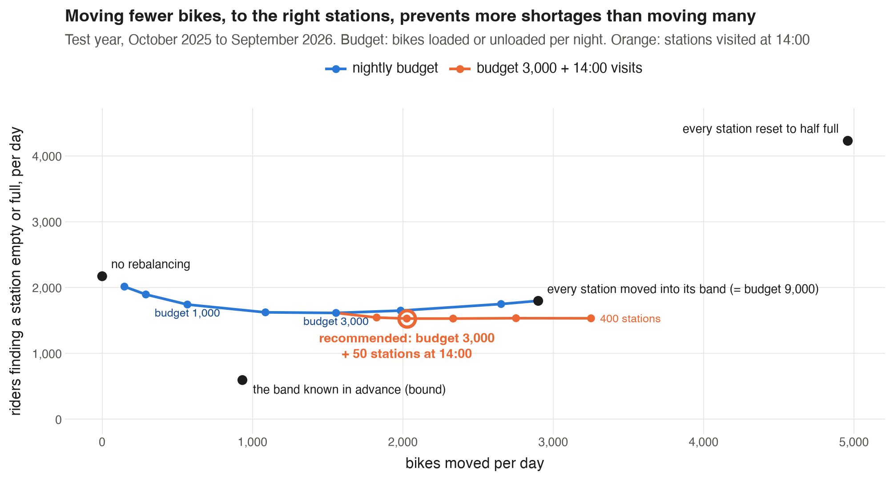

**What it shows.** For each plan, test-year averages: riders turned away per day (left) and bikes moved per day (right). Recommended in blue. The dashed line on the right is what Citi Bike reports moving, 2,514 a day. The bar for never moving a bike is cut short (it would be 18,189).

**How to read it.** You want short bars on both sides. A plan that's short on the left but long on the right buys fewer shortages with lots of truck work.

**What it tells us.**

| Plan | Turned away a day | Per 100 trips | Bikes moved a day |
|---|---|---|---|
| Never move a bike | 18,189 | 15.0 | 0 |
| Reset to half full | 4,732 | 3.9 | 5,873 |
| Every station into its band | 2,032 | 1.7 | 3,321 |
| Night budget of 3,000 | 1,945 | 1.6 | 1,877 |
| **Recommended**: budget + 100 stations at 14:00 | **1,779** | **1.5** | **2,549** |
| Band known in advance | 869 | 0.7 | 1,056 |

Four results, in order of importance:

1. **Half full moves the most bikes and still fails.** 27% of its bikes go to stations already inside their band, and it undoes the evening rush, which had already carried bikes back to the homes that need them the next morning.
2. **A few well-aimed moves beat fixing every station.** The 3,000 budget turns away 87 fewer riders than the band rule while moving 1,444 fewer bikes. Past a budget of about 4,000 it gets worse again: the extra moves act on small expected savings that are mostly noise in 10 days of history.
3. **The 14:00 visit is the best use of extra bikes.** 166 fewer shortages for 672 more bikes, 0.25 per bike. Raising the night budget from 3,000 to 4,000 instead prevents 0.06 per bike.
4. **Better forecasts are where the rest is.** With each day known in advance, the same network would turn away 869. The gap from 1,779 to 869 is day-to-day noise (figure 5), not a flaw in the rule.

Headline: **62% fewer riders turned away than half full, with 57% fewer bikes moved.**

**Likely questions.**
- *Why does a 3,000 budget move only 1,877 bikes?* The budget counts every bike loaded and every bike unloaded, one handling each. A bike moved is the larger of pick-ups and drop-offs, with a depot covering the difference.
- *Why does "band known in advance" move so few bikes?* Knowing the exact day, most stations need no change at all; the plan only acts where it matters.
- *Is 869 the true best possible?* It's the best any **overnight** plan could do. A plan with midday visits could in principle do better. (The figure's subtitle calls it a ceiling no real forecast reaches; "best overnight plan" is the accurate wording, and the figure should be fixed before hand-in.)

---

## Act 4: what it means on the street

### Figure 10. Where the vans go

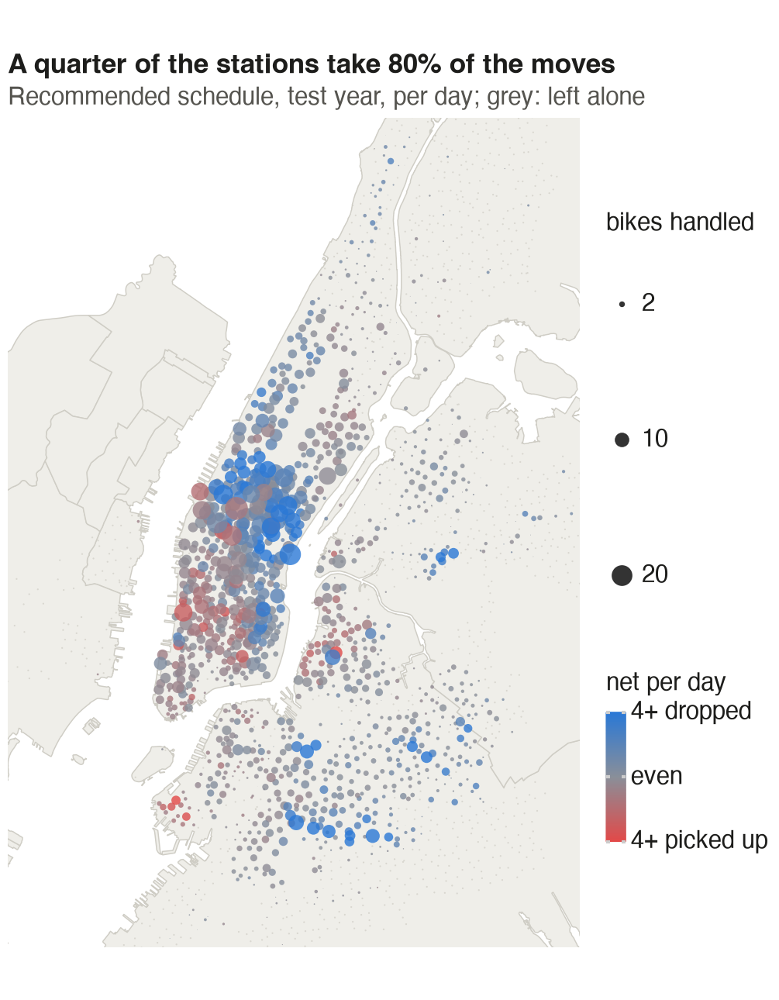

**What it shows.** Bikes handled per day at each station under the recommended plan, test year. Dot size is how many bikes the station handles (picked up plus dropped off). Colour is the net: blue mostly receives bikes, red mostly gives them up, grey is left alone or even.

**How to read it.** Big dots are where the vans spend their time. Colour says which way the bikes go.

**What it tells us.** The work is concentrated: a quarter of the stations (646) take 80% of the moves, and the busiest 10% take 49%. Manhattan takes 67% of drop-offs and Brooklyn 25%; the Bronx and Jersey City need almost nothing. Drop-offs (blue) cluster in Midtown, on the Upper West Side and in central Brooklyn, ready for the morning. Pick-ups (red) show up in Chelsea, the Financial District and around Brooklyn Heights, where evening and night trips leave bikes behind.

**Likely question.** *Why is Midtown blue (receiving), when it fills up in the morning?* By 04:00, Midtown has emptied out after the evening rush and nightlife trips. The band for many Midtown stations sits low, but stations that fell below even that get topped up. The map shows the net over the whole day, overnight and 14:00 visits included.

### Figure 11. What is left

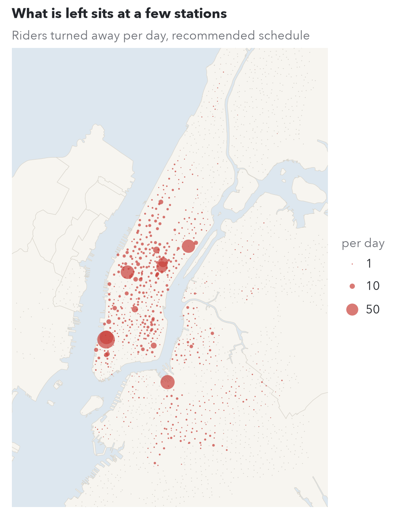

**What it shows.** Riders still turned away per day at each station under the recommended plan. Bigger dots, more shortages.

**How to read it.** Look for the handful of big dots against a sea of small ones.

**What it tells us.** Seven stations hold a quarter of all remaining shortages, 442 riders a day: North Moore St & Greenwich St and Greenwich St & Hubert St in Tribeca, Dock 72 Way & Market St in the Brooklyn Navy Yard, 9 Ave & W 33 St by Penn Station, 1 Ave & E 68 St, and E 47 and E 50 St at Park Ave. **Each swings by more than its docks on a typical workday**, like the Penn Station panel in figure 8. No truck plan fixes them; they need more docks or a valet (recommendation 2). With perfect foresight, the 20 worst stations would hold 62% of all remaining shortages.

**Likely question.** *Can't a 14:00 visit fix them?* Partly, and the plan already visits them. But the morning swing alone is bigger than the docks, so they overflow before any midday van arrives.

### Figure 12. Shortages by hour

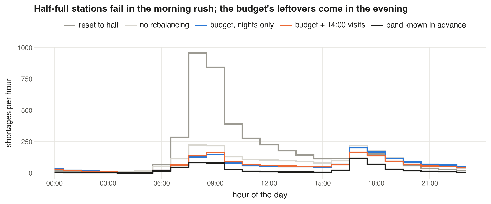

**What it shows.** Riders turned away in each hour of the day, test-year average, under four plans: reset to half (grey), the night budget alone (orange), recommended (blue) and band known in advance (dashed black).

**How to read it.** Where a line peaks is when that plan fails. Compare the peaks.

**What it tells us.**
- **Half full fails in the morning rush:** about 944 riders turned away in the 08:00 hour alone. That's the wrong starting level showing up the moment commuters leave home.
- **Under the recommended plan the worst hour is 17:00**, at about 196, when offices drain.
- **The 14:00 visit's effect is visible**: from 17:00 the blue line sits below the orange one (the night budget alone peaks at about 253 at 17:00).
- **The dashed line** is the floor for an overnight plan. Its peaks are at the same hours, just lower: some of every rush is unpredictable.

**Likely question.** *Why is blue slightly above orange in the morning rush?* The 14:00 visit sets stations up for the evening, and they carry that stock into the next night. With the night budget capped at 3,000, a few stations then start the next morning slightly off. Over the whole day the visit still wins: 166 fewer shortages a day.

### Figure 13. The reality check

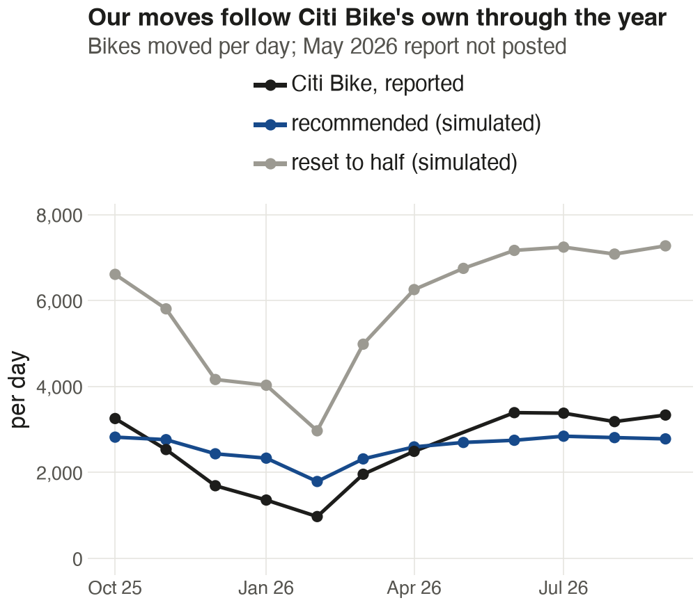

**What it shows.** Bikes moved per day in each month of the test year: Citi Bike's own reported total (black), our recommended plan (blue) and reset to half (grey). Citi Bike didn't post its May 2026 report, so that month is missing.

**How to read it.** If the blue line sits near the black one and moves with it, our plan asks for a workload Citi Bike already handles.

**What it tells us.** Our plan moves 2,572 bikes a day in the 11 months Citi Bike reports, against its 2,514, and the two rise and fall together across the months (correlation 0.92). Half full would need about twice as many all year. Citi Bike scales down harder in winter (974 a day in February 2026, against our 1,790). Shortages fall in winter too, about 250 a day in February against 2,730 in June, so our night budget could shrink in winter as well.

**Likely questions.**
- *Are these the same thing?* Not exactly. Citi Bike's number also includes valets and Bike Angels riders, so its truck work alone is smaller. Our truck workload therefore fits inside what Citi Bike already does.
- *Why does the report say 2,549 in figure 9 but 2,572 here?* Figure 9 averages all 12 months; this compares only the 11 months Citi Bike reported.

---

## The five recommendations, and the figure behind each

1. **Replace the half-full reset with a target band per station**, touching only stations outside it: 2,700 fewer riders turned away a day, 2,552 fewer bikes moved. (Figures 8, 9)
2. **Treat the seven stations whose swing beats their docks as a capacity problem**: more docks or valets, 442 riders a day. (Figures 8, 11)
3. **Send vans to the 100 neediest stations at 14:00**: 166 fewer a day for 672 bikes, the best use of extra bikes. (Figures 3, 9, 12)
4. **Cap the night at 3,000 bikes loaded or unloaded**, biggest savings first: 1,444 fewer bikes moved than banding every station, and 87 fewer riders turned away. (Figure 9)
5. **Size the night shift from the weather forecast**, but keep station targets on history. (Figures 6, 7)
