::: key
**Draft status.** Every section, figure and number is in place, and every number comes from the scripts in `citibike-rebalancing/`. Still open: the team's names, and the group's read on which charts to keep. This box comes out before submission.
:::

# 1. The business problem

On a workday, Citi Bike members start about 9,400 trips in the 08:00 hour alone, most of them from homes in Brooklyn, the East Village and the Upper West Side to offices in Midtown and Lower Manhattan, and ride back in the evening. The stations they leave run out of bikes and the ones they ride to run out of free docks, so the next rider either finds no bike or has nowhere to return one. Citi Bike, run by Lyft for the City of New York, corrects this by moving bikes with trucks, vans and cargo bikes, mostly at night, about 2,500 bikes a day by its own reports. Every bike moved costs staff time and fuel, and a move made in the wrong place costs the same while preventing nothing.

**Our question:** each night, which stations should Citi Bike restock or clear, and by how many bikes, to turn away the fewest riders the next day for each bike it moves? And is a second visit during the day worth it?

Citi Bike publishes every trip: 92.1 million of them from October 2024 to September 2026, each with its start and end station and time. Adding up the bikes that leave and arrive rebuilds every station's stock in 5-minute steps. That turns the public records into a simulator: replay a year of real riders under any schedule and count the riders it would have turned away. We build schedules from the first year and test them once on the second, which the analysis never looked at.

In short: the obvious rule, resetting every station to half full each night, moves 5,900 bikes a day and still turns away 4,700 riders. Our recommended schedule gives each station a target band drawn from its last ten comparable days and leaves stations inside it alone. Each night it moves about 1,700 bikes, taking first the moves that prevent the most shortages, and at 14:00 vans move about 800 more at the 100 stations that need it most. On the test year it turns away 1,779 riders a day (1.5 per 100 trips) and moves 2,549 bikes, about what Citi Bike reports moving. Against the half-full reset that is 62% fewer shortages with 57% fewer bikes moved. A quarter of the shortages left sit at seven stations whose daily swing is larger than their docks, and moving bikes cannot fix those.

# 2. Data, assumptions and what is missing

| Source | What it gives | Size |
|---|---|---|
| Citi Bike trip records (S3 bucket `tripdata`) | start and end time and station, bike type, member or casual rider | 92.1 million trips, Oct 2024 to Sep 2026 |
| Citi Bike live station feed (GBFS), pulled 22 Oct 2026 | number of docks per station | 2,519 stations |
| Citi Bike monthly operating reports to NYC DOT | bikes rebalanced per month | 20 months, Jan 2025 to Sep 2026 |
| Open-Meteo hourly archive, Central Park | temperature, rain, snow, wind | 17,520 hours |
| NYC Open Data, NJ GIS | borough, neighbourhood and town boundaries | 262 neighbourhoods, 12 NJ towns |

Three problems in the raw files needed fixing. Some months write station ids with one decimal, so 7293.10 appears as 7293.1 and no longer matches its station. Citi Bike's own depots, charging hub and three Los Angeles demo units appear as stations. And one monthly file repeats 512 trips. 23 February 2026 has no trips at all, since the system shut for 22 cm of snow. After the fixes, 99.9% of trips start at a public station and 99.7% end at one. We split by time: the **development year** (October 2024 to September 2025) is for exploring and for choosing every setting, and the **test year** (October 2025 to September 2026) is used once to score the final schedules.

The gaps in the data, ranked by how much they could move the results, and how we handle each:

1. **Stock is never observed.** The files hold no counts of bikes in docks and no record of the bikes Citi Bike moved itself. We rebuild stock from trips, starting from the level a schedule sets at 04:00, the quietest hour.
2. **The observed trips already include Citi Bike's own rebalancing.** Riders could take bikes that trucks had brought, so a schedule that moves fewer bikes would have seen fewer of those trips. The simulation handles this trip by trip: a rider who finds the start station empty never rides, so the bike they would have brought never reaches their destination.
3. **Lost riders leave no trace.** A rider who finds an empty station and walks away never appears in the data, so demand at stations that were often empty is undercounted. Our shortage counts are therefore lower bounds. Every schedule is replayed against the same trips, so the comparison between them holds.
4. **Dock counts are from one day.** The feed describes the network in October 2026. 81 stations are missing from it or listed with 0 docks; they hold 4.1% of trip ends and are left out of the simulation, which covers 2,470 stations.
5. **5-minute steps.** In each 5-minute slot, departures are served before arrivals, which slightly overstates shortages at the busiest stations.

# 3. When and where the flow runs one way

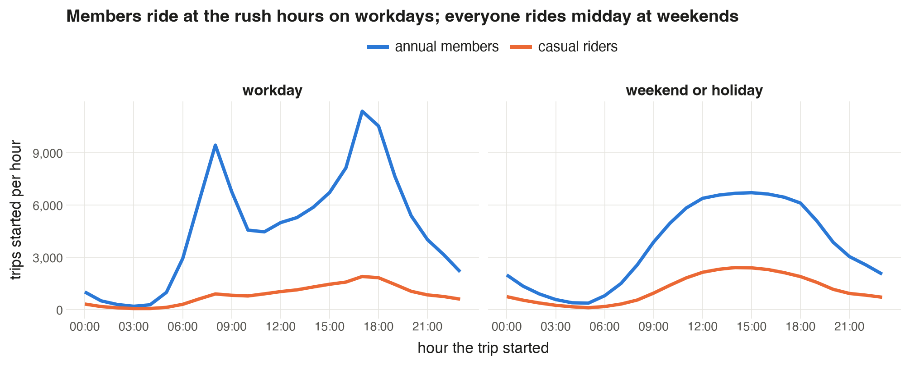{width=100%}

*Figure 1. Average trips started per hour in the development year, workdays against weekends and public holidays, annual members against casual riders.*

The imbalance is a workday commuter effect (Figure 1). Members start 9,400 trips in the 08:00 hour and 11,400 at 17:00, against 4,500 at 11:00, while casual riders barely change through the day. At weekends both groups follow one gentle midday curve. So every rule below plans workdays and weekends separately.

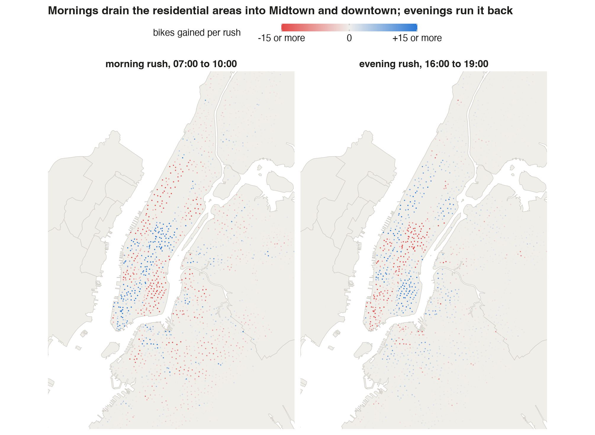{width=74%}

*Figure 2. Each station's average net flow (bikes arriving minus bikes leaving) over the workday morning rush (07:00 to 10:00) and evening rush (16:00 to 19:00), development year. The colour scale stops at 15 bikes so smaller stations still show.*

In the morning rush, 417 stations lose 5 bikes or more and 294 gain 5 or more; the largest gains 111 bikes in three hours (Figure 2). Manhattan as a whole gains 935 bikes each morning and Brooklyn loses 1,055. The evening reverses it: Manhattan loses 1,263 and Brooklyn gains 417. Stations in the Bronx, eastern Queens and Jersey City stay grey: they need little attention.

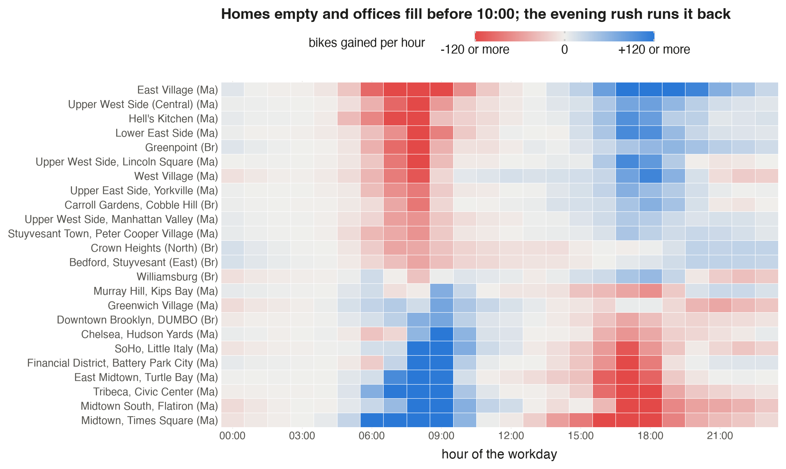{width=84%}

*Figure 3. Average workday net flow per hour, added over all stations in a neighbourhood, for the 24 neighbourhoods with the largest swings. Rows run from the neighbourhood that loses most in the morning (top) to the one that gains most.*

Each neighbourhood runs on its own timing (Figure 3). Homes empty from 06:00 to 10:00: the East Village alone loses 726 bikes over the morning rush. Offices fill over the same hours; Midtown and Times Square gain 1,119. The evening runs it back. Two details matter for the schedule. Nightlife areas such as Williamsburg and the West Village lose bikes again after 21:00. And the busiest office districts drain in a sharp window from 16:00 to 19:00, which is why a visit at 14:00 can still help them.

# 4. Can it be planned the night before?

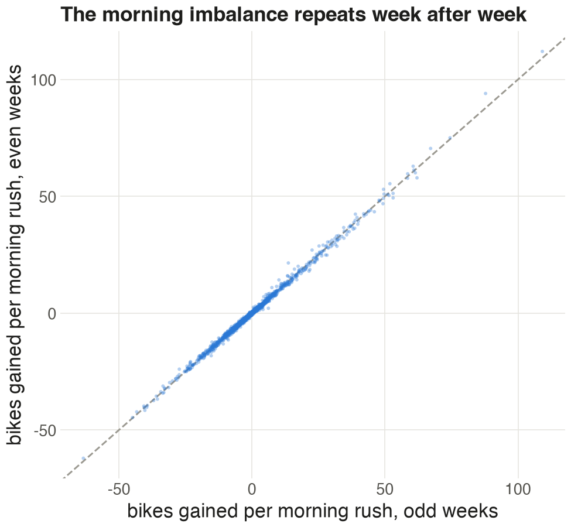{width=42%} 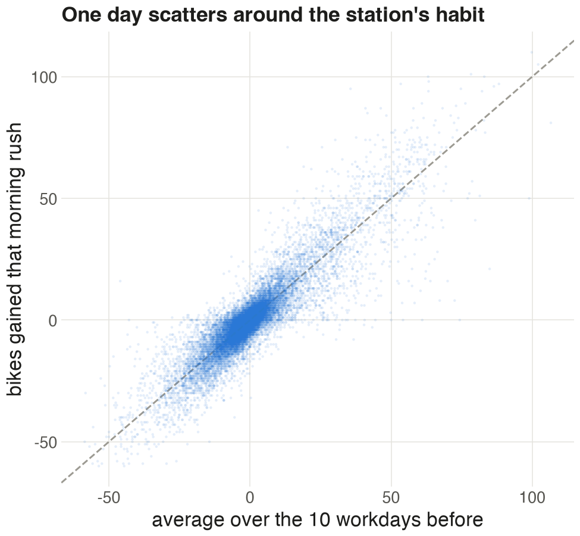{width=42%}

*Figure 4 (left). Each station's average morning-rush net flow in odd ISO weeks against even weeks of the development year, 2,190 stations. Figure 5 (right). A single workday's morning-rush net flow against the station's average over the 10 workdays before, 30,000 random station-days.*

A schedule built from past days only works if the imbalance repeats. On average it does: a station's morning flow in odd weeks matches the even weeks at a correlation of 0.998 (Figure 4). A single day is noisier. Against the average of the ten workdays before, a day's morning flow correlates at 0.90 (Figure 5), and the median station-day misses that average by 1.6 bikes. A schedule set the night before will be off at most stations by a little, and at the big ones by a lot.

How far a station's stock moves in a day decides whether one overnight setting can carry it. Starting half full, a station runs empty or full at some point on 22% of workday station-days. On only 1.3% would no starting level have worked, because the day's swing was larger than the station's docks. So almost all of the shortages from a half-full start come down to the wrong starting level.

# 5. Forecasting tomorrow

A linear regression of the log of each day's trips on the weather in riding hours (07:00 to 21:00) and the calendar, fitted on the development year, explains 87% of the day-to-day variation in the test year, with a median error of 11% (Figure 6).

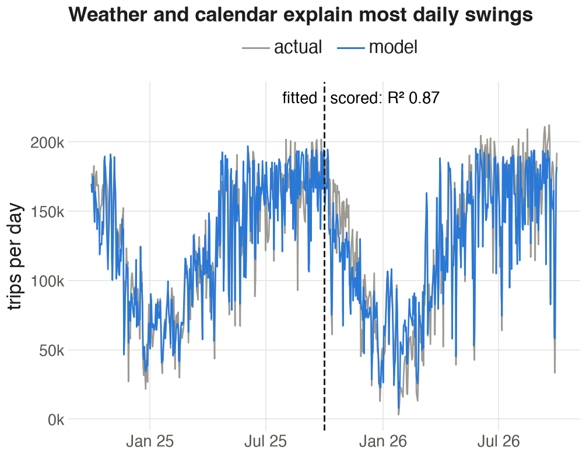{width=49%} 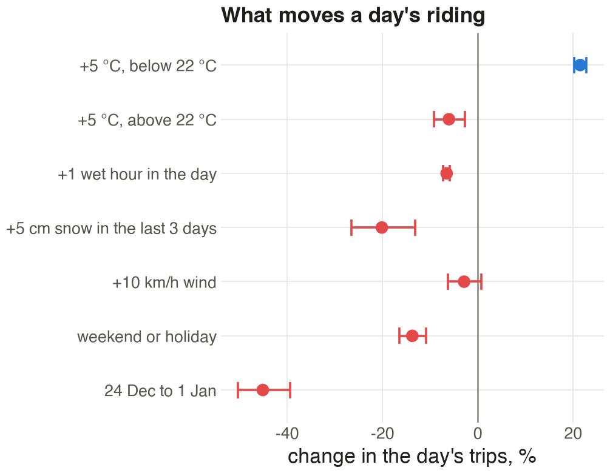{width=49%}

*Figure 6 (left). Trips per day and the model's prediction; the model is fitted left of the dashed line and scored right of it. Figure 7 (right). Each factor's effect on a day's trips, with 95% confidence intervals.*

Warmth brings riders up to about 22 °C: each 5 °C more adds 21% trips below that point, while above it, more heat costs 6%. Each wet hour in the day costs 6.6% of trips, so a day with five wet hours loses about a third. Five centimetres of snow in the last three days costs 20%, and the week from 24 December to 1 January loses 45% (Figure 7). The model has no time trend: fitted on one year, a trend picks up the season rather than growth, and adding one drops the test-year R² from 0.87 to 0.71.

Each station's starting level comes from its own last 10 comparable days, workdays or weekends. For each past day we record two numbers: the *need*, the most bikes the station fell below its 04:00 stock, and the *room*, its docks minus the most it rose above that stock. A station starting that day with x bikes would have turned away need minus x riders if x was below the need, and x minus room riders if x was above the room. Added over the 10 days, that total is lowest for any x between the 10th and 11th smallest of the 20 numbers. We call that range the station's **target band**. A station already inside its band needs no visit; one outside it is moved toward the nearest edge.

The development year settled every setting before the test year was opened:

| Setting | Options tried | Chosen | Why |
|----------------|----------------|--------|--------------------------------------------|
| Days of history | 5, 10, 20 | 10 | 20 days cut shortages by 1% for 10% more bikes moved |
| Stretch the band by tomorrow's forecast volume | yes, no | no | more shortages and more bikes moved |
| Midday visit hour | 10:00, 12:00, 14:00 | 14:00 | fewest shortages; it comes just before the evening drain |
| Night budget and midday stations | 250 to 9,000 bikes; 25 to 400 stations | 3,000 and 100 | fewest shortages while moving no more bikes than Citi Bike reported for January to September 2025, 2,707 a day |

The second row matters: the demand model forecasts volume well, yet stretching each station's past swings by it made decisions worse. Gammelli et al. (2021) find the same gap between forecast accuracy and decision quality for bike-sharing inventory. Volume forecasts are better used for sizing the night shift than for setting each station's level.

# 6. Simulating schedules on the test year

We replay every trip of the test year through all 2,470 stations, once per schedule. A rider who finds the start station empty is turned away and their trip is struck from the destination's arrivals; a rider who finds the end station full is counted as turned away too. The schedules:

- **No rebalancing**: stock carries over from day to day.
- **Reset to half full**: every station is set to half its docks at 04:00.
- **Band**: every station outside its target band is moved to the band's edge.
- **Nightly budget**: each bike moved one step toward a station's band prevents a computable number of expected shortages, and the saving shrinks as the station nears its band. We rank every such single-bike move across the network and take the best ones, up to a budget of bikes loaded or unloaded per night.
- **Budget plus a 14:00 visit** to the stations where moving to their rest-of-day band prevents the most shortages.
- **The band known in advance**: each station gets the best start for the day that actually happened. No real forecast can do better, so this marks the ceiling.

A bike moved means a bike picked up at one station and dropped at another; the depot covers any difference.

{width=100%}

*Figure 8. Stock at three stations on Tuesday 12 May 2026, a dry, ordinary workday, from the level each schedule set at 04:00. Dashed line: docks. A line flat at the dashed line or at zero means riders are being turned away.*

At Broadway & W 25 St, an office station with 109 docks, a half-full start is full by 08:45 and turns away the peak of the morning arrivals; the recommended start of 5 bikes holds out almost an hour longer (Figure 8). E 10 St & Ave A, a home station, is the mirror image: the half-full start is empty from 09:00 to 16:00, while a start near full keeps bikes there all day. And at 9 Ave & W 33 St, by Penn Station and Moynihan Train Hall, the day's swing of 181 bikes is nearly twice its 94 docks, so both schedules fail.

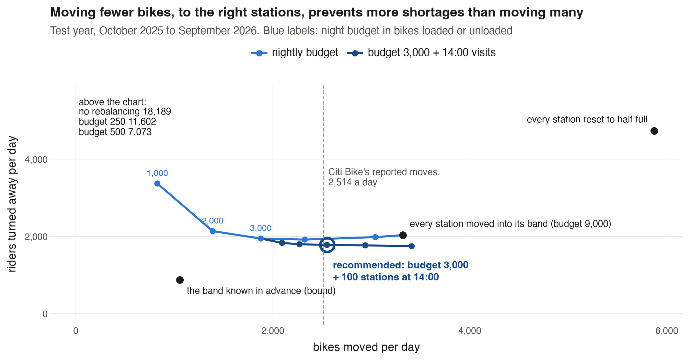{width=88%}

*Figure 9. Riders turned away per day against bikes moved per day, every schedule on the test year. The light blue curve raises the night budget from 1,000 to 9,000 bikes loaded or unloaded; the dark blue curve adds 14:00 visits to 25 to 400 stations on top of a budget of 3,000. The dashed line is what Citi Bike reports moving.*

| Schedule (test year) | Riders turned away per day | Per 100 trips | Bikes moved per day |
|------------------------------------------------|------------:|------------:|------------:|
| No rebalancing | 18,189 | 15.0 | 0 |
| Reset to half full | 4,733 | 3.9 | 5,873 |
| Every station into its band | 2,032 | 1.7 | 3,321 |
| Night budget of 3,000 | 1,945 | 1.6 | 1,878 |
| **Budget 3,000 + 100 stations at 14:00 (recommended)** | **1,779** | **1.5** | **2,549** |
| Band known in advance (ceiling) | 870 | 0.7 | 1,056 |

Four results follow from Figure 9 and the table.

1. **The half-full reset moves the most bikes and still fails.** It handles 27% of its bikes at stations already inside their band, and it leaves stations below their band on 24% of station-nights and above on 15%. The evening rush carries bikes back to the homes that need them next morning, and the reset takes many away again.
2. **Fewer, better-aimed moves beat moving every station into its band.** The night budget of 3,000 turns away 87 fewer riders a day than the band rule while moving 1,443 fewer bikes. Past a budget of 4,000, extra moves make things worse: they act on small expected savings that are mostly noise in ten days of history.
3. **The 14:00 visit is the best use of extra bikes.** Visiting 100 stations prevents 166 more shortages a day for 671 more bikes moved, 0.25 per bike. Raising the night budget from 3,000 to 4,000 instead prevents 0.06 per bike.
4. **Forecasting is where the remaining gain is.** With perfect knowledge of each day the same network would turn away 870 riders a day. The gap between 1,779 and 870 comes from day-to-day noise (Figure 5), not from the rule.

**What treating stations separately would have hidden.** A simpler simulation lets every rider arrive at their destination even if they were turned away at the start. In that version no rebalancing turns away only 2,173 riders a day, fewer than the half-full reset (4,230). That result does not survive: once lost riders also fail to arrive, stations downstream stop refilling and no rebalancing reaches 18,189. The schedules that move bikes keep the same order in both versions: the half-full reset worst, then the band rule, the night budget, and the budget with 14:00 visits best of the four (1,530 riders a day in the simple version, 1,779 in ours).

# 7. Where, when, and against Citi Bike's own operations

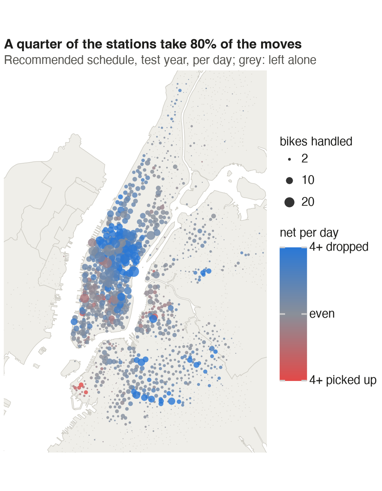{width=49%} 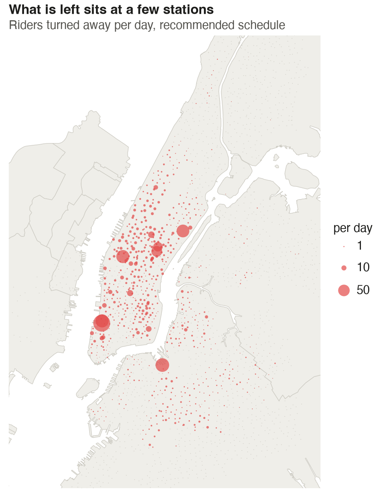{width=49%}

*Figure 10 (left). Bikes handled per day at each station under the recommended schedule, test year; blue stations mostly receive bikes, red ones mostly give them up, grey ones are left alone. Figure 11 (right). Riders turned away per day at each station under the recommended schedule.*

The work is concentrated (Figure 10): the busiest 10% of stations take 49% of all bikes handled, and 646 stations, about a quarter, take 80%. Manhattan takes 67% of the bikes dropped off and Brooklyn 25%, while the Bronx and Jersey City need almost nothing. Drop-offs dominate on the Upper West Side and in central Brooklyn, ready for the morning. Pick-ups dominate in Chelsea, the Financial District and around Brooklyn Heights, where evening and night trips leave bikes behind.

What is left is even more concentrated (Figure 11). Seven stations account for a quarter of the remaining shortages, 442 riders a day: North Moore St & Greenwich St and Greenwich St & Hubert St in Tribeca, Dock 72 Way & Market St in the Brooklyn Navy Yard, 9 Ave & W 33 St, 1 Ave & E 68 St, and E 47 and E 50 St at Park Ave. Each swings by more than its docks on a typical workday. With perfect foresight, the 20 worst stations would hold 62% of all remaining shortages. Moving bikes at 04:00 cannot fix these stations; they need more docks or a valet.

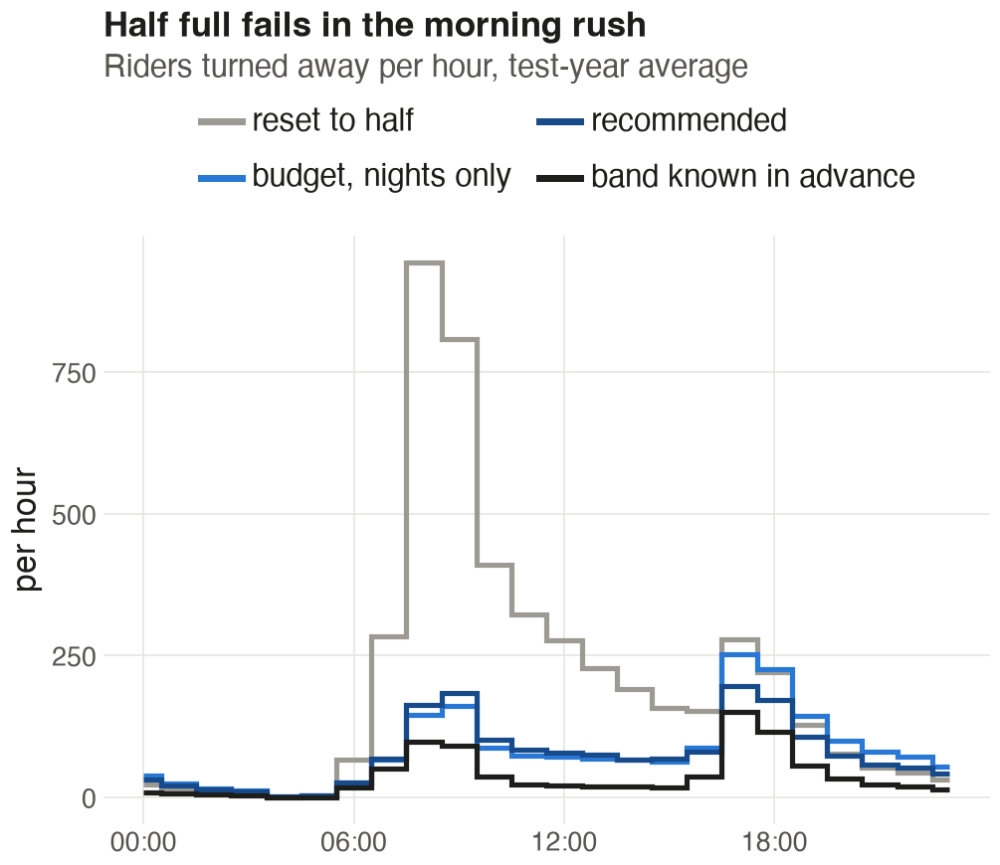{width=49%} {width=49%}

*Figure 12 (left). Riders turned away in each hour of the day, test-year average, under four schedules. Figure 13 (right). Bikes moved per day in each month of the test year: Citi Bike's reported total (trucks, vans, valets and Bike Angels) against the simulated schedules.*

Timing confirms the mechanism (Figure 12). The half-full reset fails in the morning rush, with 944 riders turned away in the 08:00 hour alone, because it set the wrong starting level. Under the recommended schedule the worst hour is 17:00, with 196, when offices drain. Without the 14:00 visit that hour would see 253.

The simulated schedule moves about as many bikes as Citi Bike does (Figure 13): 2,572 a day against the 2,514 Citi Bike reports for the same eleven months, and the two rise and fall together across the months (correlation 0.92). Citi Bike scales down harder in winter, to 974 bikes a day in February 2026 against our 1,790. Shortages follow the same season, about 250 a day in February against 2,730 in June, so the night budget could shrink in winter too. The schedule also fits the fleet: it keeps on average 38,069 bikes docked at 04:00, against a fleet of about 39,000 (NYC DOT 2025).

# 8. Recommendations

Ranked by the riders each one stops turning away on the test year:

1. **Replace the half-full reset with a target band for every station, and touch only stations outside it.** The band rule alone turns away 2,701 fewer riders a day than the reset and moves 2,552 fewer bikes. Plan workdays and weekends separately, from each station's last 10 comparable days.
2. **Treat the stations whose swing beats their docks as a capacity problem.** The seven stations named in Section 7 turn away 442 riders a day even under the recommended schedule. Trucks cannot solve them; more docks or valet staff can.
3. **Send vans to the 100 neediest stations at 14:00.** This prevents 166 shortages a day for 671 bikes moved, the best use of extra bikes in any schedule we tried.
4. **Cap the night at 3,000 bikes loaded or unloaded and take the moves that prevent the most shortages first.** Its main gain is cost: it moves 1,443 fewer bikes a night than moving every station into its band, and turns away 87 fewer riders too.
5. **Size the night shift from the weather forecast and the season, and keep station targets on history.** The demand model predicts a day's volume within 11%, which is enough to plan a lighter shift before a rainy or snowy day.

# 9. Limitations and future work

The shortage counts are lower bounds, since riders who gave up left no record. A rider who finds a full dock is counted and their bike leaves the simulation, while in reality they ride on to the next station; the depot then tops the network up, 527 bikes a day under the recommended schedule, so bikes moved are slightly overstated. Dock counts come from one day in October 2026 and are applied to both years, and the 81 stations without them are left out. The schedule ignores routing: the cost of a move depends on how far the van drives, and a vehicle-routing step (O'Mahony and Shmoys 2015) would turn the nightly list into routes. No public figure gives the cost of moving one bike, so every comparison is in bikes moved rather than dollars. Citi Bike's Bike Angels programme, which pays riders to ride against the flow (Chung et al. 2018), also moves bikes at no truck cost; part of the budget could go to rider rewards. Finally, the gap to the ceiling (1,779 against 870 shortages a day) means better station-level forecasts, for example from events, school calendars or subway disruptions, are worth more than any further tuning of the rule.

# References

\small

Chung, H., Freund, D., & Shmoys, D. B. (2018). Bike Angels: An analysis of Citi Bike's incentive program. *Proceedings of the ACM SIGCAS Conference on Computing and Sustainable Societies (COMPASS)*.

Citi Bike. (2026). System data: trip histories, October 2024 to September 2026. https://citibikenyc.com/system-data

Citi Bike. (2026). Monthly operating reports, January 2025 to September 2026. https://citibikenyc.com/system-data/operating-reports

Citi Bike. (2026). General Bikeshare Feed Specification, station information, retrieved 22 October 2026. https://gbfs.citibikenyc.com/gbfs/en/station_information.json

Gammelli, D., Wang, Y., Prak, D., Rodrigues, F., Minner, S., & Pereira, F. C. (2021). Predictive and prescriptive performance of bike-sharing demand forecasts for inventory management. arXiv:2108.00858.

NYC Department of City Planning. (2020). 2020 Neighborhood Tabulation Areas; Borough Boundaries. NYC Open Data.

NYC Department of Transportation. (2025). Citi Bike expansion plan presentation, Bronx Community Board 8, 15 May 2025.

O'Mahony, E., & Shmoys, D. B. (2015). Data analysis and optimization for (Citi)Bike sharing. *Proceedings of the AAAI Conference on Artificial Intelligence*, 29(1).

Open-Meteo. (2026). Historical weather API, hourly archive for Central Park, New York. https://open-meteo.com

Raviv, T., & Kolka, O. (2013). Optimal inventory management of a bike-sharing station. *IIE Transactions*, 45(10), 1077-1093.

State of New Jersey, Office of GIS. (2026). Municipal boundaries of New Jersey (Hudson County).
