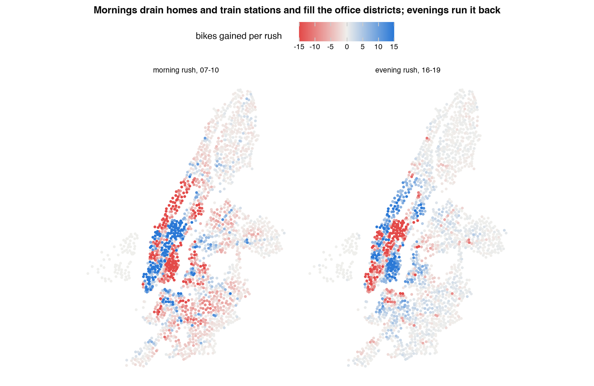
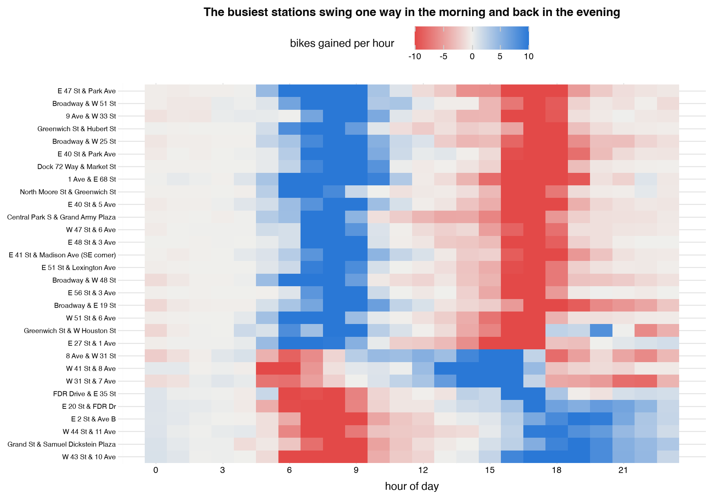
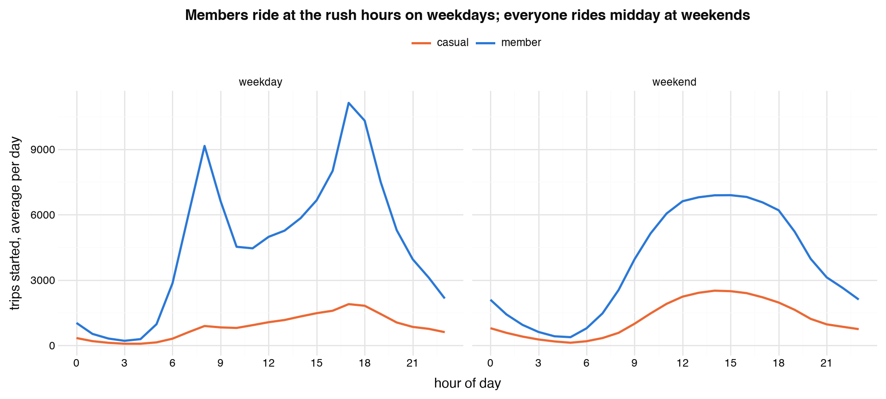
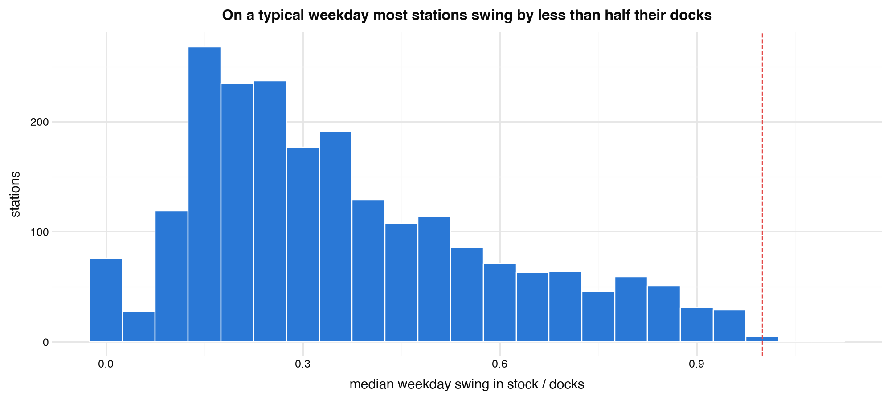

::: key
**Where we are.** The first half of the report is ready: the problem, the data and four charts that show where and when bikes pile up and run out. The second half, which schedule Citi Bike should run and what it saves, is not built yet. Handed in today, the report would score well on the problem statement and on the data, but it would lose most of the analysis marks (25%) and part of the visualisation marks (50%), because no chart shows the answer yet.

**What we need from the group:** two decisions (section 5) and a rough split of who writes which part.
:::

# 1. The problem

Every weekday morning, commuters ride from homes in upper Manhattan and Brooklyn to offices in Midtown and Lower Manhattan, and ride back in the evening. The stations they leave run out of bikes and the stations they ride to run out of free docks, so the next rider finds no bike, or nowhere to return one. Citi Bike fixes this by moving bikes with trucks, vans and cargo bikes, and every move costs money. Our question: **which stations should Citi Bike restock or clear, by how many bikes, and at what time of day, to prevent the most shortages for the bikes it moves?**

The report follows the four steps from our movie outline as one argument: describe when and where the flow runs one way, diagnose why it repeats, predict each station's flow for the next day, and prescribe a rebalancing schedule tested on a year the analysis never looked at. The last step sets each station's overnight stock to the level that keeps it from running empty or full the next day, the method of Raviv and Kolka (2013), and close to how Cornell researchers planned Citi Bike's own overnight moves (O'Mahony and Shmoys 2015).

# 2. The data

| Source | What it gives us |
|---|---|
| Citi Bike trip records, October 2024 to September 2026 | 92.1 million trips: start and end time, start and end station, bike type, member or casual rider |
| Citi Bike's live station feed, pulled 22 October 2026 | the number of docks at each of 2,519 stations |
| Open-Meteo hourly weather, Central Park | temperature and rain for every hour of the two years |

The first year (October 2024 to September 2025) is for exploring and building the schedule. The second year is kept aside and used once at the end to test it, so the result shows how the schedule would have done on days it never saw. All numbers below come from the first year.

Assumptions and gaps the report has to justify (20% of the grade asks for this):

1. Only completed trips are recorded. A rider who found a station empty and walked away leaves no trace, so demand at stations that often run empty is undercounted, and every shortage figure is a lower bound.
2. The data has no stock levels. It never says how many bikes sat at a station, or which bikes Citi Bike moved itself, so stock is rebuilt from the trips, starting from an assumed level.
3. Dock counts come from the live feed of 22 October 2026. 81 stations are missing from it or listed as out of service; they hold 4.1% of trip ends and are left out wherever capacity matters.
4. The raw files needed fixing: station ids lose trailing zeros in some months, Citi Bike's depot and demo sites appear as stations, one monthly file repeats 512 trips, and 23 February 2026 has no trips at all (22 cm of snow). All of these are fixed and documented in the notebook.

# 3. What we found

Ranked by how much each finding shapes the schedule.

**1. Each station's imbalance repeats almost exactly.** A station's average morning flow in odd weeks matches its average in even weeks at a correlation of 0.998. On average, a schedule planned from past weeks will fit the weeks after it; how well it does on a single day is what the test year will show.

**2. The map shows the problem in one picture.** In the average weekday morning rush, 402 stations lose 5 bikes or more and 289 gain 5 or more. The residential Upper West and Upper East Sides and much of Brooklyn lose bikes, Midtown and Lower Manhattan gain them, and the evening runs it back.

**3. The busiest stations swing one way in the morning and back in the evening.** The 30 stations with the largest swings fall into three groups: 21 office-district stations fill in the morning and empty in the evening, six residential stations near the rivers do the opposite, and three around Penn Station and Port Authority empty from 05:00 and refill from noon, which fits train commuters.

**4. The commuters cause it.** On weekdays, members start about 9,200 trips in the 08:00 hour and 11,200 in the 17:00 hour, against about 4,500 at 11:00. Weekends follow one midday curve, so weekdays and weekends need separate plans.

**5. Setting the right overnight level would solve most shortage days.** A station that starts the day half full runs empty or full at some hour on 20.5% of weekdays. On only 1.1% would no starting level have worked. So the right overnight level, if known in advance, would have avoided 95% of the short days without moving any bikes during the day. Nine stations swing by more than all their docks on a typical weekday; those need a midday visit.

**6. Weather changes how many people ride, not where the bikes go.** At the same temperature, a wet day brings 9% to 45% fewer riders than a dry one, but a day's imbalance rises and falls with its trip count (correlation 0.97). And no single route matters: the 300 busiest routes together carry only 3.6% of morning trips, so the schedule targets stations, not routes.

# 4. Is it good enough for a top grade?

Checked against the four parts of the Appendix C grading, heaviest first.

| Part (weight) | What we have | What is missing | Verdict |
|---|---|---|---|
| **Data visualisation (50%)** | Four strong descriptive charts: the rush map, the station heatmap, time of day, drift against capacity. One colour scheme throughout (red for losing bikes, blue for gaining, orange for casual riders) | The charts that show the answer: which schedule wins and by how much. The maps also need borough names, since a reader who does not know New York cannot tell Midtown from Brooklyn. The charts need resizing for print | Half there. The descriptive charts are report-ready after small fixes; the decision charts do not exist yet |
| **Analysis and discussion (25%)** | Six findings, each tied to what it means for the schedule, and the limitations listed in section 2 | The simulation: shortages and bikes moved for each schedule on the test year, and the recommendation that follows from it | Not there yet. This is the main work left |
| **Problem statement (20%)** | One clear business problem, how the data answers it, and every assumption and gap justified | Novelty: Citi Bike data is a common choice in student projects. Our angle (dock capacity, a full test year, a schedule tested against real trips) is stronger than the usual demand chart, and the report should say so in its opening | Close to ready. Needs one paragraph that sets us apart |
| **Writing (5%)** | The notebook text is written and checked; a reference list exists | The report itself is not written | Not started |

The source code we hand in (as HTML) is in good shape: it runs from start to finish and explains every step. The grade comes from the report, so the remaining effort goes there.

# 5. Next steps and decisions

What is left, in order:

1. **Build the simulation.** Replay the test year's real trips against each station's docks and compare five schedules: no rebalancing, a nightly reset to half full, a nightly reset to each station's best level from a forecast, the same plus a midday visit for the stations that need one, and the same with a cap on bikes moved per night.
2. **Make the decision charts.** A trade-off curve of shortages against bikes moved, one point per schedule; a map of each station's best overnight level; one example day showing a station's stock hour by hour under each schedule; and what the midday visit adds at the nine hardest stations.
3. **Turn the best 8 to 10 charts into report figures.** Add borough labels to the maps, resize for print, and drop charts that repeat another.
4. **Write the report** as one argument from the problem to the recommendation, 8 pages, no code.

Two decisions for the group:

1. **Costs.** We can show shortages against bikes moved as a curve with no prices, or put a cost on each bike moved and each missed trip and recommend one schedule in dollars. Dollars make a stronger recommendation, but the cost figures would be our own estimates and need a source or a justification.
2. **Fleet size.** The nightly targets can either add up to the real number of bikes in the system, which is more realistic, or be set station by station, which is simpler but makes the result look better than it would be in practice.

The presentation runs in weeks 11 and 12 (26 October to 6 November) and the report is due Friday 13 November, 23:59, so the simulation needs to be done before the presentation slot.
